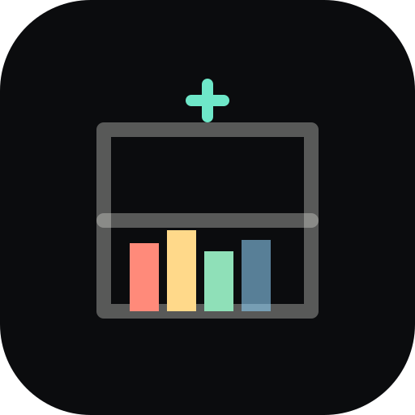
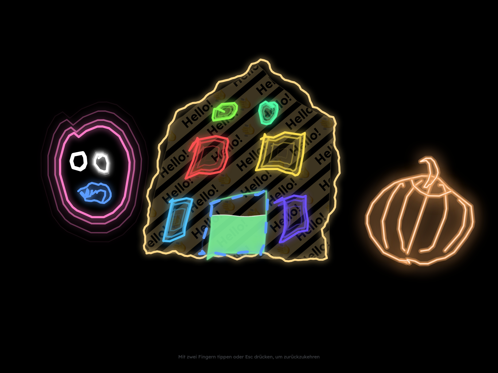
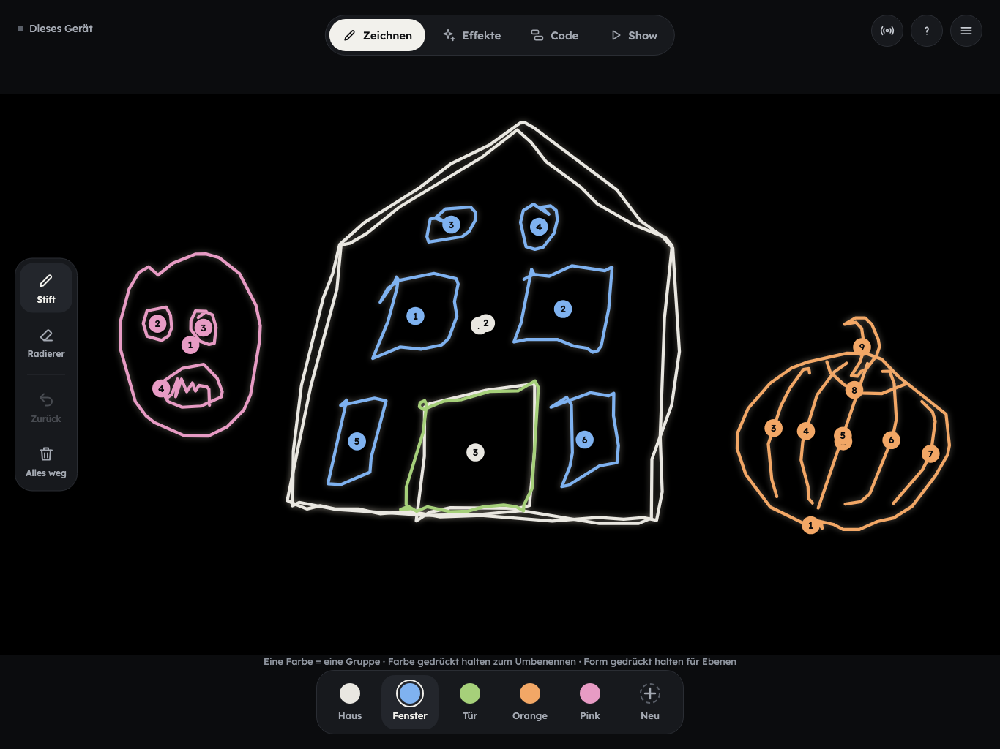
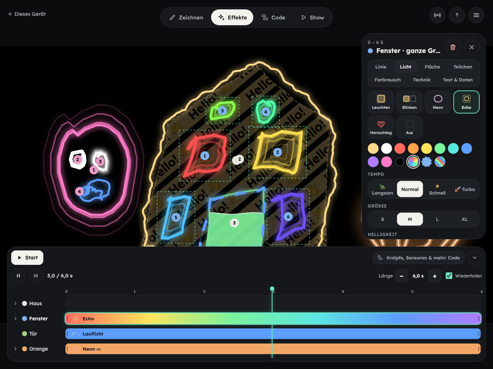
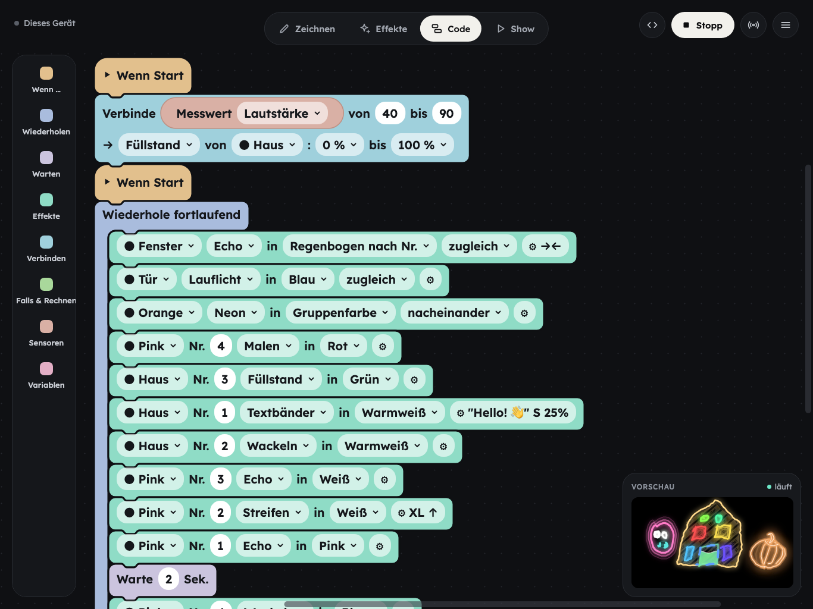
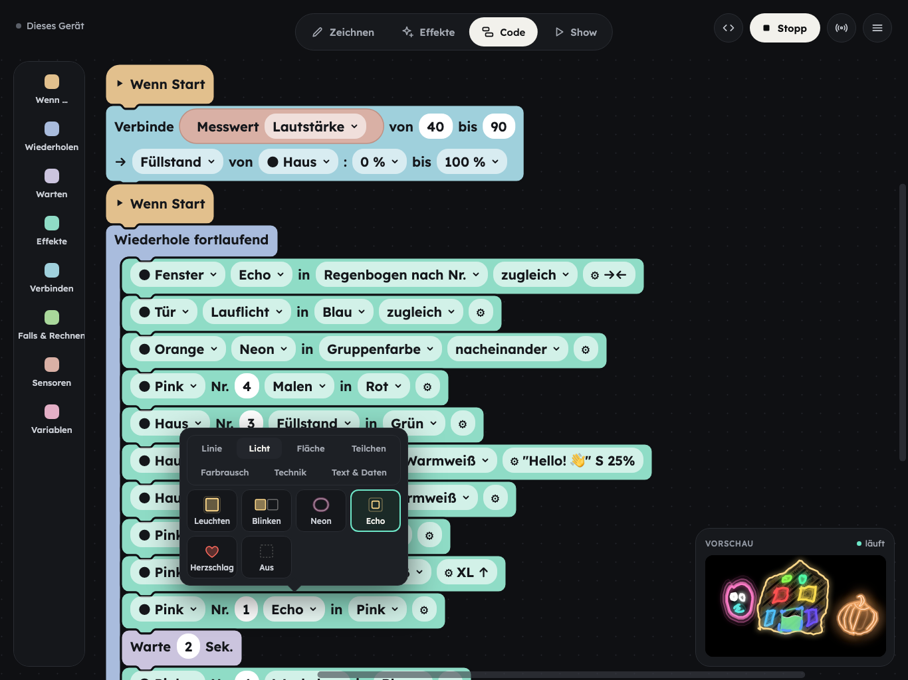

<div align="center">



# Lichtwerk

**Projection mapping for kids.** Trace real things on the wall, make them glow, and let sensor data change the light.

Next.js · TypeScript · Blockly · runs in the browser · German & English

[Modes](#four-modes) · [Workshop](#a-workshop-in-four-steps) · [Getting started](#getting-started) · [Setups](#setups) · [senseBox](#sensors-sensebox) · [Status](#status)

<br />



<sub><i>Show mode, projected on a wall: house, face and pumpkin traced by hand, each with its own light effect.</i></sub>

</div>

<br />

| ✏️ Trace | ✨ Light | 🧩 Program | 📡 Sense |
| :-- | :-- | :-- | :-- |
| Kids trace edges they see on the wall with a finger. Each pen colour is a group they name themselves. | More than 30 light effects, from neon and confetti to scrolling text and glitch, with speed, size, colour and direction. | Blockly blocks decide what happens and when: conditions, loops, variables, buttons. | A senseBox sends temperature, distance and more over Bluetooth. Louder = faster, warmer = redder. |

## Four modes

<table>
  <tr>
    <td width="50%" valign="top">
      
      <h3>✏️ Zeichnen · Draw</h3>
      Pick a pen colour and trace what you see on the wall. Strokes are smoothed and close automatically. Every stroke gets a number, so a single window can be addressed later.
    </td>
    <td width="50%" valign="top">
      
      <h3>✨ Effekte · Effects</h3>
      The no-code path: one looping show on a timeline. Tap a row to add an effect, drag to move it, and set colour, speed, size and direction in the inspector.
    </td>
  </tr>
  <tr>
    <td width="50%" valign="top">
      
      <h3>🧩 Code</h3>
      The show is the baseline; code adds what the data does to it. <code>Verbinde ⟨Lautstärke⟩ → Füllstand</code> lets a sensor steer a setting, <code>Solange ⟨Temperatur &gt; 20⟩</code> switches an effect on while it's warm.
    </td>
    <td width="50%" valign="top">
      
      <h3>🎨 Visual pickers</h3>
      Effects, colours and settings are picked from animated grids instead of long text lists, so kids who can't read every word still find their way.
    </td>
  </tr>
</table>

**Show** turns the whole screen into light: no interface, only the projection (and the on-screen buttons a program uses).

## A workshop in four steps

Designed for 2–4 hours with grades 5–7. Younger kids can stay in the Effects mode.

1. **Program the senseBox** so it sends its readings (temperature, distance, loudness …).
2. **Trace the scene** on the wall: a house, a face, a shelf, whatever is there.
3. **Design a show** in Effects: what should it look like without any data?
4. **Connect the data** in Code: what changes when it gets louder, warmer or someone comes closer?

No senseBox at hand? The sensor dialog has sliders to try everything out.

## Getting started

```bash
npm install
npm run dev                      # http://localhost:3000
```

For a workshop, build once and serve it on the local network:

```bash
npm run build
npm run start -- -H 0.0.0.0      # open http://<laptop-ip>:3000 on the iPads
```

> [!NOTE]
> Web Bluetooth and "Add to Home Screen" need HTTPS or `localhost`. On the local network, put the app behind HTTPS (e.g. `caddy`, `mkcert` or a deployed URL).

Projects are saved in the browser automatically and can be exported or imported as JSON from the menu.

## Setups

| Setup | How |
| :-- | :-- |
| **iPad + projector** | Mirror the iPad. Works on every iPad; the dark interface keeps the wall dark, and Show mode gives the clean result. |
| **Laptop + projector** | Menu → *Open output window*. Chrome and Edge place it on the second screen; editor and output stay in sync. |
| **iPad + laptop output** | Planned. Needs a small network relay. |

## Sensors (senseBox)

The Bluetooth profile follows **senseBox:bike**: one characteristic per phenomenon, float32 values. Temperature, humidity, fine dust, distance and acceleration are mapped in [`src/lib/sensors.ts`](src/lib/sensors.ts); unknown characteristics still show up as "Sensor XXXX".

> [!IMPORTANT]
> Safari on iPadOS has no Web Bluetooth. Connect the senseBox from Chrome or Edge on a laptop (or Android/ChromeOS).

## Status

Lichtwerk is an early prototype. It has been tested in desktop browsers at iPad size, **not yet on a real iPad, projector or senseBox**. Loudness has no Bluetooth characteristic yet, and there is no sync between devices.

Ideas for later: sync from an iPad to a laptop output, corner-pin warping when the projector moves, state blocks (traffic light), a step mode for debugging, sharing projects.

Architecture notes for contributors are in [`CLAUDE.md`](CLAUDE.md).
